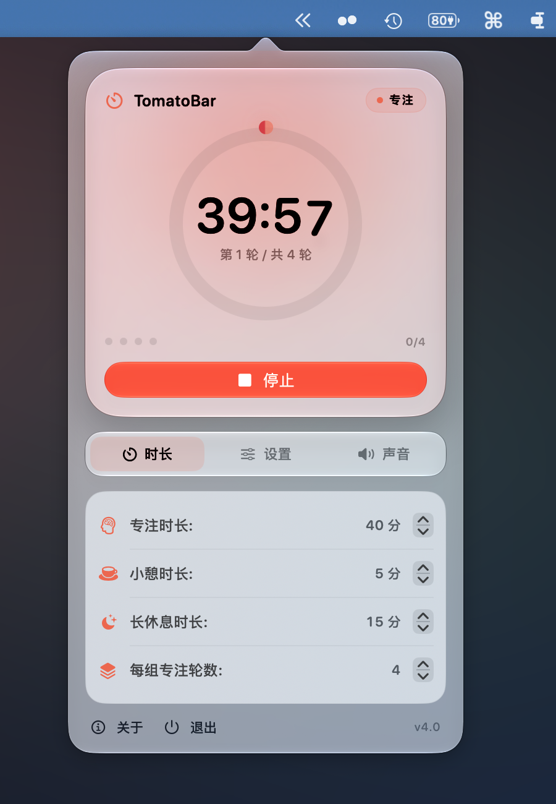

<p align="center">

<p>
 
<h1 align="center">TomatoBar</h1>
<p align="center">
   
</p>

<p align="center">
  
  <br/>
  <sub>TomatoBar on macOS 27 — Liquid Glass, live progress dial, and session markers.</sub>
</p>

## Overview
TomatoBar is a focused Pomodoro timer that lives in your macOS menu bar. It keeps the
technique simple: choose a focus interval, work until the timer ends, take a short break,
and take a longer break after a full set.

Version 4 is rebuilt for **macOS 27** and adopts the **Liquid Glass** design language. The
popover now has a live progress dial, session markers, glass controls, and a cleaner
settings layout, while the timer engine is more reliable across sleep, wake, and repeated
intervals.

## Requirements
- macOS 27 or later
- Apple silicon Mac

## Features
- Configurable focus, short break, and long break intervals
- Focus sets with a long break after the final interval
- Animated Liquid Glass progress dial and session markers
- Countdown in the menu bar (optional)
- Global start/stop shortcut
- Actionable notifications with a **Skip break** action
- Windup, ding, and ticking sounds with independent volume controls and previews
- Launch at login
- Sandboxed, with no network access
- JSON event log for productivity analysis
- `tomatobar://` URL scheme for automation

## Install
Download the latest release <a href="https://github.com/ivoronin/TomatoBar/releases/latest/">here</a> or install using Homebrew:
```
brew install --cask tomatobar
```

If the app doesn't start, install using the `--no-quarantine` flag:
```
brew install --cask --no-quarantine tomatobar
```

## Integration with other tools
### Event log
TomatoBar logs state transitions in JSON format to
`~/Library/Containers/com.github.ivoronin.TomatoBar/Data/Library/Caches/TomatoBar.log`.
The log is checked at launch and rotated when it exceeds 5 MB (one `.1` backup is kept).
Use this data to analyze your productivity and enrich other data sources.

### Starting and stopping the timer
TomatoBar can be controlled using `tomatobar://` URLs. To start or stop the timer from the
command line:
```
open tomatobar://startStop
```
To skip a break:
```
open tomatobar://skipRest
```
To open or close the popover:
```
open tomatobar://show
open tomatobar://hide
```

## Development
Open `TomatoBar.xcodeproj` in Xcode 27, select the TomatoBar scheme, and run. The app is a
menu bar app (`LSUIElement`), so it does not appear in the Dock.

## Builds and releases
GitHub Actions builds every push on the `xcode-27` runner. Pushes to any branch publish a
rolling **prerelease** named `prerelease`; pushing a `v*` tag publishes a normal release.
Builds are ad-hoc signed, not notarized, and the downloadable archive is attached to the
release together with its SHA-256 checksum.

## Older versions
Touch bar integration is available in TomatoBar versions prior to 3.0. Versions prior to 4.0
support older macOS releases.

## Licenses
 - Timer sounds are licensed from buddhabeats
